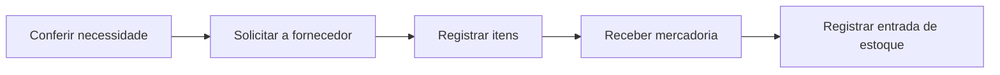

# Fluxos operacionais propostos

## Venda

## Compra

Fluxos reduzidos para demonstração da proposta técnica. Consultar os processos relatados na Entrega 1, que incluem receita/laudo, garantia e trocas.
