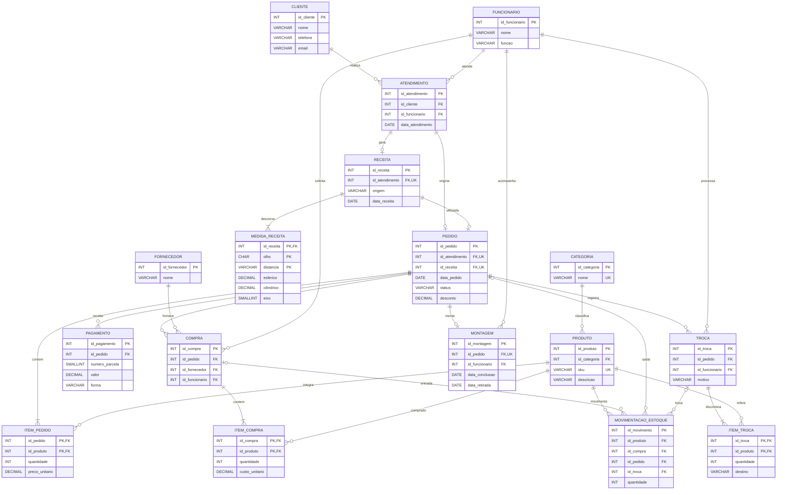

# Modelo lógico relacional — versão revisada

Representação das tabelas, PK/FK e relações. Código Mermaid para visualização no GitHub; tipos e constraints completos no [script SQL](../docs/script.sql) e [dicionário de dados](../docs/dicionario_dados.html).

**Notação requerida no trabalho final:** brModelo (com tipos, PK, FK e cardinalidades (mín,máx)); converter/validar este desenho se necessário.
