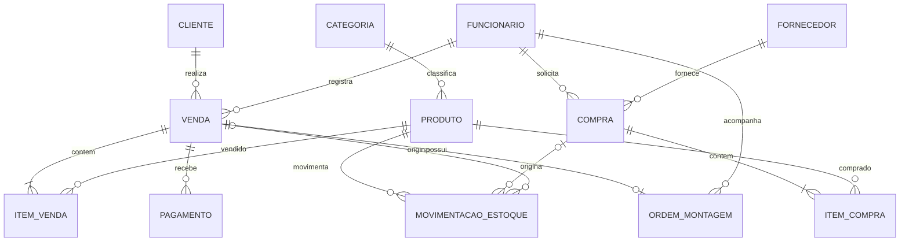

# Modelo lógico proposto (não é o DER final validado)

**Atenção:** representação Mermaid para consulta rápida. O original da E1 foi produzido com notação brModelo e tem escopo maior: [DER original](https://github.com/jfpiresoficial/Entrega-1-Modelo-Conceitual-DER---otica-kadosh-modelagem-dados/blob/main/DER_conceitual_BRMW_HD.jpg). A cardinalidade aqui é proposição, não correção final homologada.
